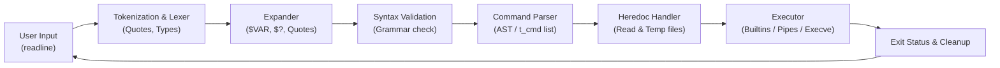

# Minishell

---

## 📌 About The Project

> **This project was developed as part of the 42 School curriculum.**

**Minishell** is a 42 school group project that consists of writing a mini Unix shell from scratch in **C**. Inspired by Bash (Bourne Again SHell), the objective is to implement a command-line interpreter that parses, manages environment state, handles signals, manipulates processes, and executes command lines with pipes and redirections.

---

## 📑 Table of Contents

- [Features](#-features)
  - [Command Execution & Builtins](#command-execution--builtins)
  - [Redirections & Heredoc](#redirections--heredoc)
  - [Pipes & Multi-Commands](#pipes--multi-commands)
  - [Variables & Environment](#variables--environment)
  - [Signal Handling](#signal-handling)
- [Architecture & Workflow](#-architecture--workflow)
- [Project Structure](#-project-structure)
- [Getting Started](#-getting-started)
  - [Prerequisites](#prerequisites)
  - [Compilation](#compilation)
  - [Execution](#execution)
- [Examples](#-examples)
- [Authors](#-authors)

---

## ✨ Features

### Command Execution & Builtins
The shell can execute external binaries found in directories listed in the `PATH` environment variable, or direct relative/absolute paths (e.g. `/bin/ls`, `./my_script.sh`).

It also implements the following standard Bash builtins:
- `echo` with support for the `-n` flag
- `cd` with relative or absolute path (updates `PWD` and `OLDPWD`)
- `pwd` with no options
- `export` with no options (alphabetically sorted list) or to export variables (supporting `VAR=value` and append `VAR+=value`)
- `unset` with no options to remove environment variables
- `env` with no options or arguments to display current environment
- `exit` with optional exit code argument and proper numeric checks

### Redirections & Heredoc
- `<` : Redirects input from a file.
- `>` : Redirects output to a file (overwrites).
- `>>` : Redirects output in append mode.
- `<< [DELIMITER]` : Heredoc (reads input until a line matching the delimiter is seen):
  - Properly handles variable expansion inside heredoc unless the delimiter contains quotes.
  - Generates isolated temporary files and cleans them up after execution.
  - Safely interruptible with `Ctrl+C`.

### Pipes & Multi-Commands
- Pipeline chaining with `|` across arbitrary numbers of commands.
- Correct pipeline process management: forks child processes, establishes file descriptor pipes, duplicates standard inputs/outputs, and waits for all children before returning the last command's exit code.

### Variables & Environment
- Environment stored dynamically in a linked list structure (`t_env`).
- Automatic increment of `SHLVL` upon initialization.
- Tracks `$_` (last executed command argument).
- Variable expansion:
  - `$VAR` expanded to its value from the environment.
  - `$?` expanded to the exit status of the most recently executed foreground pipeline.
  - Proper quoting rules:
    - Single quotes (`' '`): inhibits all expansion and meta-character interpretations.
    - Double quotes (`" "`): inhibits word splitting and metacharacters, but allows `$VAR` / `$?` expansion.

### Signal Handling
- `Ctrl + C` (`SIGINT`):
  - In interactive prompt: displays a new prompt line.
  - In blocking process: terminates foreground child command and displays newline.
  - In heredoc: aborts the input stream and sets status code to 130.
- `Ctrl + \` (`SIGQUIT`):
  - Ignored in the interactive prompt.
  - Prints `Quit (core dumped)` when terminating a child process.
- `Ctrl + D` (`EOF`):
  - Exits the shell cleanly if typed on an empty line.

---

## 🏗️ Architecture & Workflow

The shell follows a clean pipeline design:



1. **Reading Input**: Captured via GNU `readline` with persistent history tracking (`add_history`).
2. **Tokenization**: Segments raw strings into tokens (`WORD`, `PIPE`, `INPUT`, `OUTPUT`, `APPEND`, `HEREDOC`) considering quote scopes.
3. **Expansion & Splitting**: Expands environment variables and `$?`, taking single/double quote contexts into account.
4. **Syntax Validation**: Ensures tokens adhere to shell grammar (prevents consecutive unescaped pipes, trailing redirects without targets, etc.).
5. **Command Table Construction**: Parses tokens into linked structures of commands (`t_cmd`) containing argument arrays and redirection lists (`t_red`).
6. **Heredoc Pre-processing**: Collects heredoc inputs upfront before process execution.
7. **Execution**:
   - Single builtins execute in the parent process (preserving state changes for `cd`, `export`, `unset`, `exit`).
   - Pipelines and external commands fork child processes, configure pipes, resolve executable paths from `$PATH`, and invoke `execve`.

---

## 📁 Project Structure

```
.
├── Execution/              # Process management, execution and builtins
│   ├── builtins.c          # Dispatcher for builtin commands
│   ├── cd.c & cd_utils.c   # 'cd' implementation & PWD updates
│   ├── echo.c              # 'echo' implementation (-n flag)
│   ├── env.c               # 'env' command
│   ├── exit.c              # 'exit' builtin & argument validation
│   ├── export.c & utils    # 'export' builtin (sorting & appending)
│   ├── handle_paths*.c     # PATH discovery & binary validation
│   ├── heredoc*.c          # Heredoc processing & temp file management
│   ├── pipe*.c             # Pipeline execution and fork/fd management
│   ├── pwd.c               # 'pwd' command
│   ├── red.c               # Redirection file descriptors handling
│   ├── shlvl.c             # SHLVL tracking
│   ├── signals.c           # Signal handlers (SIGINT, SIGQUIT)
│   ├── single_cmd*.c       # Single command execution flow
│   └── unset.c             # 'unset' command
├── Parsing/                # Input lexical analysis and parsing
│   ├── env_init.c          # Environment variable list initialization
│   ├── expand*.c           # Variable expansion & quote elimination
│   ├── free_*.c            # Safe memory cleanup routines
│   ├── parsing*.c          # Command list tree builder
│   ├── split_tokens.c      # Word-splitting after expansion
│   ├── syntax_error.c      # Syntax error checking rules
│   └── tokenisation*.c     # Lexer & token creation
├── Libft/                  # Custom standard C utility library
├── main.c                  # Main interactive loop & prompt
├── minishell.h             # Main header file and struct definitions
└── Makefile                # Build configuration
```

---

## 🚀 Getting Started

### Prerequisites

Ensure you have a C compiler (`gcc` or `clang`) and the GNU `readline` library installed:

- **Debian / Ubuntu**:
  ```bash
  sudo apt-get update
  sudo apt-get install build-essential libreadline-dev
  ```

- **macOS** (Homebrew):
  ```bash
  brew install readline
  ```

### Compilation

Build the executable using the provided Makefile:

```bash
make
```

Available Makefile targets:
- `make` : Compiles libft and the `minishell` executable.
- `make clean` : Removes object files (`.o`).
- `make fclean` : Removes object files and the `minishell` binary.
- `make re` : Recompiles the entire project.

### Execution

Launch the shell:

```bash
./minishell
```

---

## 💡 Examples

```bash
minishell$ echo "Hello, 42 World!"
Hello, 42 World!

minishell$ export GREETING="Minishell project"
minishell$ echo $GREETING
Minishell project

minishell$ cat << EOF | grep "important" > output.txt
> normal line
> important line to keep
> EOF
minishell$ cat output.txt
important line to keep

minishell$ ls -la | grep Makefile | wc -l
1

minishell$ cd .. && pwd
/path/to/parent

minishell$ echo "Exit status check"
Exit status check
minishell$ echo $?
0

minishell$ exit
```

---

